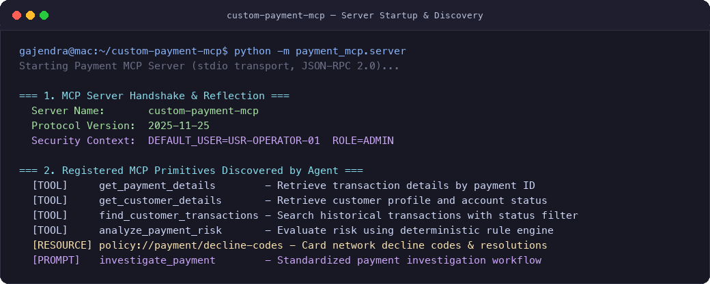
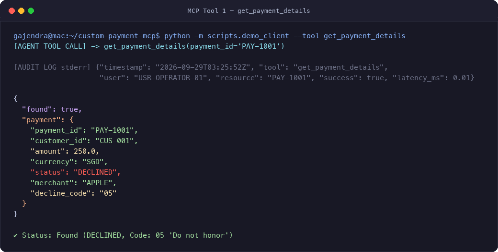
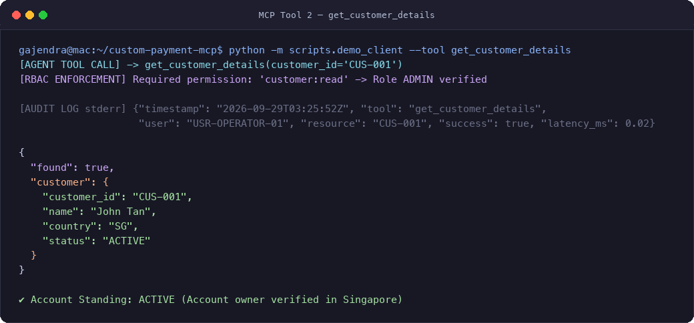
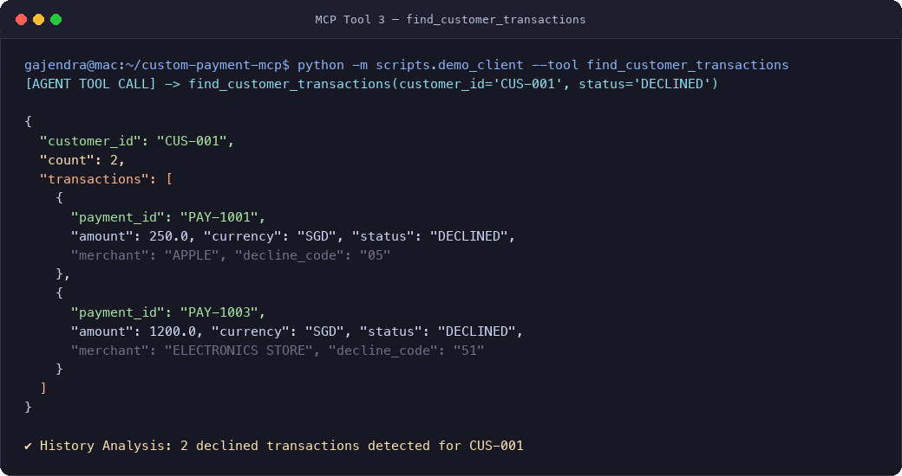
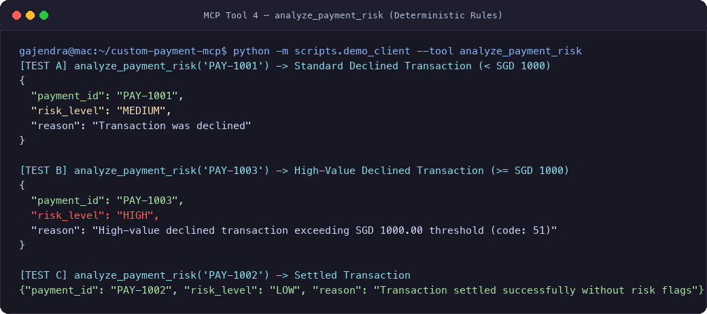
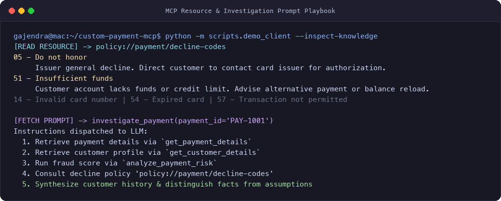
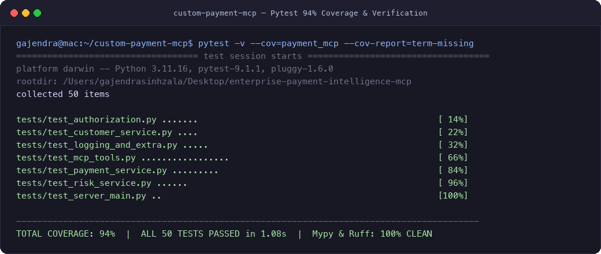

# custom-payment-mcp

An enterprise-grade **Payment Investigation Model Context Protocol (MCP) Server** built with **Python 3.11+**, **FastMCP**, **Pydantic v2**, and a strict layered architecture.

This project exposes secure payment investigation capabilities—payment lookup, customer profiling, transaction history search, deterministic risk evaluation, and decline policy resolution—to AI agents (such as Claude, Gemini, or custom LLM orchestrators).

---

## Table of Contents

1. [Step-by-Step Local Execution Guide](#step-by-step-local-execution-guide)
2. [Testing Each Function (With Screenshots)](#testing-each-function-with-screenshots)
   - [1. Server Startup & Protocol Handshake](#1-server-startup--protocol-handshake)
   - [2. Tool: get_payment_details](#2-tool-get_payment_details)
   - [3. Tool: get_customer_details](#3-tool-get_customer_details)
   - [4. Tool: find_customer_transactions](#4-tool-find_customer_transactions)
   - [5. Tool: analyze_payment_risk](#5-tool-analyze_payment_risk)
   - [6. Resource & Investigation Prompt](#6-resource--investigation-prompt)
   - [7. Automated Pytest Suite & Code Coverage](#7-automated-pytest-suite--code-coverage)
3. [What is MCP?](#what-is-mcp)
4. [MCP vs REST](#mcp-vs-rest)
5. [MCP vs Agent-to-Agent (A2A)](#mcp-vs-agent-to-agent-a2a)
6. [Architecture & Separation of Concerns](#architecture--separation-of-concerns)
7. [Project Structure](#project-structure)
8. [Security & RBAC Architecture](#security--rbac-architecture)
9. [Audit Logging & Observability](#audit-logging--observability)
10. [Example End-to-End Investigation Scenario](#example-end-to-end-investigation-scenario)
11. [Production Architecture Evolution](#production-architecture-evolution)
12. [Docker Deployment](#docker-deployment)
13. [Connecting to AI Agents (Claude Desktop, Cursor, Custom Agents)](#connecting-to-ai-agents)

---

## Step-by-Step Local Execution Guide

Follow these steps to set up, run, and test the project locally from scratch:

### Step 1: Clone and Prepare Virtual Environment
Make sure you have **Python 3.11 or newer** installed:

```bash
# Navigate to the workspace directory
cd enterprise-payment-intelligence-mcp

# Create an isolated Python 3.11+ virtual environment
python3.11 -m venv .venv

# Activate the virtual environment
source .venv/bin/activate
```

### Step 2: Install Package in Editable Mode
Install the server and all development/testing dependencies:

```bash
# Upgrade pip
pip install --upgrade pip

# Install project and dev dependencies in editable mode
pip install -e ".[dev]"
```

### Step 3: Run the All-in-One Verification Script
We provide a dedicated client runner script `scripts/demo_client.py` that boots the local MCP server over `stdio`, initializes the session, and executes every tool, resource, and prompt:

```bash
python scripts/demo_client.py
```

### Step 4: Run the Automated Test Suite & Coverage
Run all 50 unit and integration tests with line-by-line coverage:

```bash
pytest -v --cov=payment_mcp --cov-report=term-missing
```

### Step 5: Verify Code Quality (Ruff & Mypy)
```bash
# Linting & Formatting
ruff check .
ruff format --check .

# Strict static type check
mypy src tests
```

### Step 6: Launch the MCP Server for AI Agent Integration
To run the server as a background subprocess listening for JSON-RPC commands from Claude Desktop, Cursor, or your custom LLM agent:

```bash
python -m payment_mcp.server
```

*(Note: In `stdio` mode, the server listens for JSON-RPC 2.0 frames on standard input and emits structured audit logs to `stderr`.)*

---

## Testing Each Function (With Screenshots)

Below are detailed walkthroughs and actual terminal screenshots demonstrating the testing of each tool, resource, prompt, and test suite.

---

### 1. Server Startup & Protocol Handshake

When an AI agent connects to `custom-payment-mcp` over `stdio`, it sends an `initialize` JSON-RPC request. The server responds with its capabilities and reflections of all registered tools, resources, and prompts.

```bash
# Run server reflection via demo client
python scripts/demo_client.py
```



**Key Observations:**
- Server negotiates protocol version cleanly.
- Identity and permissions are initialized to `DEFAULT_USER=USR-OPERATOR-01` with `ROLE=ADMIN`.
- Four executable tools, one policy resource, and one investigation prompt are exposed to the AI agent.

---

### 2. Tool: `get_payment_details`

Retrieves structured payment transaction data by payment ID. Returns transaction amount, currency, merchant, settlement status, and ISO 8583 decline codes.

```bash
# Direct Python test
python -c '
from payment_mcp.server import server
import asyncio
res = asyncio.run(server.call_tool("get_payment_details", {"payment_id": "PAY-1001"}))
print(res.structured_content)
'
```



**Output Data:**
```json
{
  "found": true,
  "payment": {
    "payment_id": "PAY-1001",
    "customer_id": "CUS-001",
    "amount": 250.0,
    "currency": "SGD",
    "status": "DECLINED",
    "merchant": "APPLE",
    "decline_code": "05"
  }
}
```

---

### 3. Tool: `get_customer_details`

Fetches customer account profiling data. Enforces RBAC: requires `customer:read` permission (only `CUSTOMER_SUPPORT` and `ADMIN` roles are permitted; `READ_ONLY` is rejected).

```bash
# Direct Python test
python -c '
from payment_mcp.server import server
import asyncio
res = asyncio.run(server.call_tool("get_customer_details", {"customer_id": "CUS-001"}))
print(res.structured_content)
'
```



**Output Data:**
```json
{
  "found": true,
  "customer": {
    "customer_id": "CUS-001",
    "name": "John Tan",
    "country": "SG",
    "status": "ACTIVE"
  }
}
```

---

### 4. Tool: `find_customer_transactions`

Searches historical transactions for a customer, with optional filtering by `SETTLED` or `DECLINED` status.

```bash
# Direct Python test
python -c '
from payment_mcp.server import server
import asyncio
res = asyncio.run(server.call_tool("find_customer_transactions", {"customer_id": "CUS-001", "status": "DECLINED"}))
print(res.structured_content)
'
```



**Output Data:**
```json
{
  "customer_id": "CUS-001",
  "count": 2,
  "transactions": [
    {
      "payment_id": "PAY-1001",
      "customer_id": "CUS-001",
      "amount": 250.0,
      "currency": "SGD",
      "status": "DECLINED",
      "merchant": "APPLE",
      "decline_code": "05"
    },
    {
      "payment_id": "PAY-1003",
      "customer_id": "CUS-001",
      "amount": 1200.0,
      "currency": "SGD",
      "status": "DECLINED",
      "merchant": "ELECTRONICS STORE",
      "decline_code": "51"
    }
  ]
}
```

---

### 5. Tool: `analyze_payment_risk`

Executes deterministic fraud risk rules through the isolated `RiskEngine` interface:
- **Settled transactions (`PAY-1002`)**: Assessed as `LOW` risk.
- **Declined transactions under SGD 1,000 (`PAY-1001`)**: Assessed as `MEDIUM` risk (`"Transaction was declined"`).
- **Declined transactions $\ge$ SGD 1,000 (`PAY-1003`)**: Assessed as `HIGH` risk (`"High-value declined transaction exceeding SGD 1000.00 threshold"`).

```bash
# Direct Python test
python -c '
from payment_mcp.server import server
import asyncio
for pid in ["PAY-1001", "PAY-1003", "PAY-1002"]:
    res = asyncio.run(server.call_tool("analyze_payment_risk", {"payment_id": pid}))
    print(pid, "->", res.structured_content)
'
```



---

### 6. Resource & Investigation Prompt

- **Resource (`policy://payment/decline-codes`)**: Static documentation providing decline code descriptions and customer resolution advice.
- **Prompt (`investigate_payment`)**: A reusable playbook guiding an AI agent through a rigorous 8-step investigation methodology.

```bash
# Read policy resource
python -c '
from payment_mcp.server import server
import asyncio
res = asyncio.run(server.read_resource("policy://payment/decline-codes"))
print(res[0].content)
'
```



---

### 7. Automated Pytest Suite & Code Coverage

The automated test suite exercises 50 test cases covering:
- Valid / invalid / unknown payments
- Valid / invalid / unknown customer accounts
- Settled vs. declined filtering
- Threshold-based risk scoring
- Zero-trust RBAC authorization and permission matrices
- Unauthenticated vs. forbidden security rejections
- Audit log capture, PII masking, and telemetry counters

```bash
pytest -v --cov=payment_mcp --cov-report=term-missing
```



---

## What is MCP?

The **Model Context Protocol (MCP)** is an open standard that enables AI models and autonomous agents to securely discover and interact with external data sources, contextual documents, and executable tools in a consistent, protocol-agnostic manner.

```text
User
  │
  ▼
AI Agent / LLM
  │
  │ Model Context Protocol (JSON-RPC over stdio / SSE)
  ▼
Custom Payment MCP Server
  │
  ├── Tools     (Executable business functions: payment lookup, risk analysis)
  ├── Resources (Contextual documents: decline code policies, compliance manuals)
  └── Prompts   (Reusable prompt engineering workflows: investigation playbooks)
```

### Core Primitives in MCP:

| Primitive | Purpose | Payment Domain Example |
| :--- | :--- | :--- |
| **Tool** | Model-callable executable function with typed arguments and JSON schema. Returns dynamic results. | `get_payment_details(payment_id="PAY-1001")`, `analyze_payment_risk` |
| **Resource** | Read-only contextual data, documents, or knowledge files addressed via URI. | `policy://payment/decline-codes` |
| **Prompt** | Reusable, parameterized template instructing the LLM on specific workflows. | `investigate_payment(payment_id="PAY-1001")` |

---

## MCP vs REST

| Aspect | REST (Representational State Transfer) | MCP (Model Context Protocol) |
| :--- | :--- | :--- |
| **Primary Consumer** | Software applications, frontends, microservices. | AI Agents, Large Language Models (LLMs), Agent Frameworks. |
| **Interface Discovery** | Manual OpenAPI/Swagger inspection or hardcoded client endpoints. | Automatic schema reflection: the LLM dynamically inspects tools, parameters, descriptions, and types at runtime. |
| **Interaction Flow** | Client issues explicit HTTP requests (GET/POST/PUT/DELETE) knowing the endpoint path beforehand. | The LLM reasons about the user's intent, autonomously selects the appropriate tool, constructs arguments matching the JSON schema, and evaluates the output. |
| **Context & Knowledge** | Requires custom endpoints returning arbitrary payloads; no native prompt or document abstraction. | Provides standardized primitives for static context (`Resources`) and workflow guidance (`Prompts`) in addition to executable `Tools`. |
| **Transport** | Primarily HTTP/1.1 or HTTP/2 over TCP. | JSON-RPC 2.0 over standard I/O (`stdio`), Server-Sent Events (`SSE`), or Streamable HTTP. |

> **Summary**: REST is designed for deterministic application-to-application integration. MCP provides a standardized interface for AI applications to discover and interact with tools, resources, and prompts dynamically without custom integration code.

---

## MCP vs Agent-to-Agent (A2A)

```text
MCP Protocol:                Agent-to-Agent (A2A):
+----------+                 +----------+         +----------+
| AI Agent |                 | AI Agent |         | AI Agent |
+----+-----+                 | (Planner)|         | (Worker) |
     | MCP                        +----+---------------+----+
     ▼                                 | A2A Protocol       |
+----+-----+                           ▼                    ▼
|  Tools   |                    Delegates Subtasks  Collaborative
|  Data    |                    & Negotiates        Consensus
+----------+
```

- **MCP (`Agent ↔ Tools/Data`)**: Standardizes how a single agent connects to tools, APIs, enterprise databases, and static resources. The server is reactive and executes commands on behalf of the agent.
- **A2A (`Agent ↔ Agent`)**: Standardizes how autonomous agents communicate, negotiate, hand off tasks, and collaborate with peer or hierarchical agents.

---

## Architecture & Separation of Concerns

`custom-payment-mcp` is designed using enterprise clean architecture principles:

```text
                  User
                    │
                    ▼
              AI Agent / LLM
                    │
                    │ JSON-RPC (stdio / SSE)
                    ▼
       +─────────────────────────────+
       │     FastMCP Server Layer    │
       │  (Tools, Resources, Prompts)│
       +──────────────┬──────────────+
                      │
       +──────────────▼──────────────+
       │       Security & Audit      │
       │  • Verified SecurityContext │
       │  • Zero-Trust RBAC Guards   │
       │  • PII-Scrubbed Audit Log   │
       │  • Telemetry Metrics Engine │
       +──────────────┬──────────────+
                      │
       +──────────────▼──────────────+
       │        Service Layer        │
       │  • PaymentService           │
       │  • CustomerService          │
       │  • RiskService (Pluggable)  │
       +──────────────┬──────────────+
                      │
       +──────────────▼──────────────+
       │       Repository Layer      │
       │  • PaymentRepository (ABC)  │
       │  • CustomerRepository (ABC) │
       +──────────────┬──────────────+
                      │
       +──────────────▼──────────────+
       │   Persistence / Data Store  │
       │  • Thread-safe In-Memory    │
       │  • Production SQL/NoSQL DB  │
       +─────────────────────────────+
```

---

## Project Structure

```text
custom-payment-mcp/
│
├── pyproject.toml              # Project metadata, dependencies, ruff, mypy, pytest config
├── README.md                   # Comprehensive architectural and usage documentation
├── .env.example                # Configuration template
├── .gitignore                  # Git ignore rules
├── Makefile                    # Automation shortcuts (install, test, lint, run, docker)
├── Dockerfile                  # Production multi-stage, non-root Docker build
├── .dockerignore               # Docker build exclusions
│
├── scripts/
│   ├── demo_client.py          # Interactive demonstration and verification script
│   └── render_screenshots.py   # Automated high-resolution screenshot generator
│
├── docs/
│   └── screenshots/            # Verified terminal screenshots of each MCP capability
│       ├── 01_server_handshake.png
│       ├── 02_tool_payment_details.png
│       ├── 03_tool_customer_details.png
│       ├── 04_tool_find_transactions.png
│       ├── 05_tool_analyze_risk.png
│       ├── 06_resource_and_prompt.png
│       └── 07_test_suite_coverage.png
│
├── tests/
│   ├── __init__.py
│   ├── test_payment_service.py # Unit tests for PaymentService
│   ├── test_customer_service.py# Unit tests for CustomerService
│   ├── test_risk_service.py    # Unit tests for RiskService & RiskEngine
│   ├── test_authorization.py   # Unit tests for RBAC, SecurityContext, permissions
│   ├── test_mcp_tools.py       # End-to-end integration tests for tools, resource, prompt
│   ├── test_logging_and_extra.py# Tests for JSONFormatter, audit decorator, error handling
│   └── test_server_main.py     # Tests for server entrypoint and transport selection
│
└── src/
    └── payment_mcp/
        ├── __init__.py         # Package exports
        ├── server.py           # FastMCP server registration (tools, resource, prompt)
        ├── config.py           # Pydantic Settings loaded from environment
        ├── logging_config.py   # Stdio-safe structured JSON logging to stderr
        │
        ├── models/
        │   ├── __init__.py
        │   ├── payment.py      # Payment, PaymentStatus, response schemas
        │   ├── customer.py     # Customer, CustomerStatus, response schemas
        │   └── risk.py         # RiskResult, RiskLevel schemas
        │
        ├── repositories/
        │   ├── __init__.py
        │   ├── payment_repository.py  # PaymentRepository ABC & InMemory thread-safe implementation
        │   └── customer_repository.py # CustomerRepository ABC & InMemory implementation
        │
        ├── services/
        │   ├── __init__.py
        │   ├── payment_service.py     # Payment business logic & validation
        │   ├── customer_service.py    # Customer intelligence logic
        │   └── risk_service.py        # Pluggable RiskEngine & RiskService
        │
        ├── security/
        │   ├── __init__.py
        │   ├── authorization.py       # RBAC roles, permissions, SecurityContext
        │   └── audit.py               # Structured audit logging & telemetry metrics
        │
        └── data/
            ├── __init__.py
            └── seed.py                # Seed payments, customers, and decline code policies
```

---

## Security & RBAC Architecture

### 1. Zero-Trust Principal Identity
In traditional toy MCP implementations, the LLM passes user arguments or pretends to be an administrator. In `custom-payment-mcp`, security is enforced via a verified `SecurityContext`.

```python
class SecurityContext(BaseModel):
    user_id: str
    role: Role  # ADMIN, CUSTOMER_SUPPORT, ANALYST, READ_ONLY
    token_claims: dict[str, str] = Field(default_factory=dict)
```

### 2. Role-Based Permission Matrix

| Role | `payment:read` | `transactions:search` | `customer:read` | `risk:analyze` |
| :--- | :---: | :---: | :---: | :---: |
| `READ_ONLY` |  Yes |  Yes |  No |  No |
| `CUSTOMER_SUPPORT` |  Yes |  Yes |  Yes |  No |
| `ANALYST` |  Yes |  Yes |  No |  Yes |
| `ADMIN` |  Yes |  Yes |  Yes |  Yes |

### 3. Safe Error Handling
If an unauthorized caller invokes a tool, no stack traces or internal implementation details are leaked. The server logs the security event and returns a structured response:
```json
{
  "found": false,
  "error": "Access denied: Role 'READ_ONLY' does not have permission 'customer:read'.",
  "error_type": "SecurityError"
}
```

---

## Audit Logging & Observability

### 1. Structured Audit Log (JSON to `stderr`)
Every tool execution generates an immutable audit record capturing timing, principal, resource, and outcome:
```json
{
  "timestamp": "2026-09-29T03:17:36.789279+00:00",
  "level": "INFO",
  "logger": "payment_mcp.audit",
  "message": "{\"timestamp\": \"2026-09-29T03:17:36.789279+00:00\", \"tool_name\": \"get_payment_details\", \"user_id\": \"USR-OPERATOR-01\", \"resource_id\": \"PAY-1001\", \"success\": true, \"duration_ms\": 0.01, \"error_type\": null}"
}
```

### 2. Privacy & Secret Scrubbing
The audit engine scrubs any parameter matching sensitive keywords:
- `password`, `secret`, `token`, `access_token`, `api_key`
- `credit_card`, `cvv`, `pan`, `ssn`

### 3. Telemetry Metrics Collector
An in-memory metrics accumulator exposes real-time operational metrics for Prometheus/OpenTelemetry scraping:
```python
{
    "get_payment_details": {
        "invocations": 14,
        "errors": 0,
        "auth_failures": 0,
        "average_latency_ms": 0.05,
    }
}
```

---

## Example End-to-End Investigation Scenario

### User Query:
> *"Why was PAY-1001 declined?"*

### Agent Tool Orchestration:
```text
Step 1: AI calls get_payment_details("PAY-1001")
        ↳ Result: Amount=SGD 250, Status=DECLINED, DeclineCode="05", Customer="CUS-001"

Step 2: AI calls get_customer_details("CUS-001")
        ↳ Result: Name="John Tan", Country="SG", Status="ACTIVE"

Step 3: AI calls analyze_payment_risk("PAY-1001")
        ↳ Result: RiskLevel="MEDIUM", Reason="Transaction was declined"

Step 4: AI reads resource policy://payment/decline-codes
        ↳ Result: Code 05 = "Do not honor - The issuing bank has declined the transaction without specific reason. Direct customer to contact card issuer."

Step 5: AI calls find_customer_transactions("CUS-001")
        ↳ Result: 2 transactions (both declined: PAY-1001 and high-value PAY-1003)
```

### Expected AI Agent Response:
> **Payment Investigation Report: PAY-1001**
>
> - **Transaction Overview**: Payment `PAY-1001` for **SGD 250.00** at merchant **APPLE** was **DECLINED**.
> - **Customer Profile**: Account holder **John Tan** (`CUS-001`, Singapore) has an **ACTIVE** account status.
> - **Decline Root Cause**: Decline code **`05` (Do not honor)** was returned by the card issuing bank. Per bank policy, code `05` indicates a general issuer-level refusal without an automated retry provision.
> - **Risk Assessment**: **MEDIUM**. While the customer account is in good standing, recent transaction history reveals another declined transaction (`PAY-1003` for SGD 1,200.00 with code `51` Insufficient Funds).
> - **Recommended Action**: Advise the customer to contact their card-issuing bank to authorize charges for Apple or provide an alternate card.

---

## Production Architecture Evolution

```text
                        Enterprise AI Agent
                                │
                                │ mTLS / HTTPS
                                ▼
                     API Gateway / Envoy Proxy
                     • Rate limiting & Throttling
                     • JWT / OIDC Token Verification
                     • WAF & Prompt Injection Inspection
                                │
                                │ Authenticated Request + Injected Claims Header
                                ▼
                  Custom Payment MCP Server Pods
                  (Kubernetes / ECS / Cloud Run)
                                │
       +────────────────────────┼────────────────────────+
       │                        │                        │
       ▼                        ▼                        ▼
Authentication             Zero-Trust              Audit Logger
(Extracts user_id,         RBAC Guard              (Masks PII, emits to
 roles from JWT claims)    (Validates permissions)  CloudWatch/Splunk)
                                │
                                ▼
                        Service Mesh Layer
                                │
       +────────────────────────┼────────────────────────+
       │                        │                        │
       ▼                        ▼                        ▼
  Payment Core API         Customer Master API       Fraud ML Microservice
  (Circuit Breaker,        (mTLS, Retries)          (Triton / SageMaker)
   Timeouts, Idempotency)
```

---

## Docker Deployment

### 1. Build Docker Image

```bash
docker build -t custom-payment-mcp:latest .
```

### 2. Run Docker Container

```bash
# Stdio mode for local agent integration
docker run -i --rm -e MCP_TRANSPORT=stdio custom-payment-mcp:latest

# SSE mode for network service
docker run -d --rm -p 8000:8000 -e MCP_TRANSPORT=sse -e MCP_PORT=8000 custom-payment-mcp:latest
```

---

## Connecting to AI Agents

### 1. Claude Desktop Configuration
Add the server configuration to `claude_desktop_config.json`:

```json
{
  "mcpServers": {
    "custom-payment-mcp": {
      "command": "/Users/gajendrasinhzala/Desktop/enterprise-payment-intelligence-mcp/.venv/bin/python",
      "args": [
        "-m",
        "payment_mcp.server"
      ],
      "env": {
        "DEFAULT_ROLE": "ADMIN",
        "LOG_LEVEL": "INFO"
      }
    }
  }
}
```

### 2. Cursor / Windsurf Configuration
Configure under MCP settings:
- **Type**: `command`
- **Command**: `python -m payment_mcp.server`
- **Working Directory**: `/path/to/enterprise-payment-intelligence-mcp`

### 3. Programmatic Python SDK Integration
```python
import asyncio
from mcp import ClientSession, StdioServerParameters
from mcp.client.stdio import stdio_client


async def main():
    params = StdioServerParameters(
        command=".venv/bin/python",
        args=["-m", "payment_mcp.server"],
    )
    async with stdio_client(params) as (read, write):
        async with ClientSession(read, write) as session:
            await session.initialize()
            result = await session.call_tool("get_payment_details", {"payment_id": "PAY-1001"})
            print(result)


asyncio.run(main())
```
